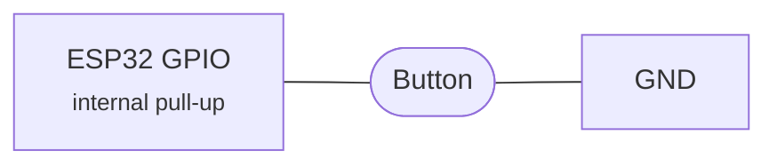
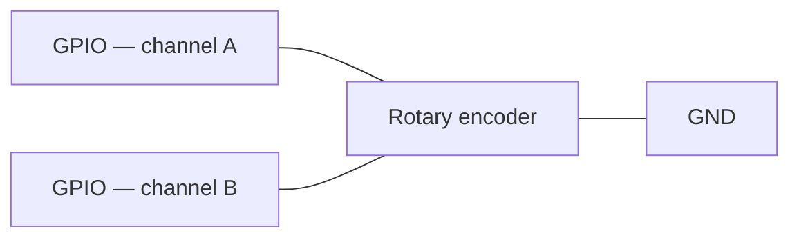

# Hardware buttons

Physical buttons can control playback directly from the device, with no phone involved.
They work with AirPlay, Bluetooth, USB and Sendspin sources.

## How the commands reach the phone

A speaker cannot pause a phone by itself: it has to ask the phone to pause. The receiver
does it the way Apple's own receivers do, and picks the route from what the sender is:

| Source | Play/pause and track skip | Volume |
| --- | --- | --- |
| **AirPlay 2** (iOS, macOS) | Sent to the phone as a MediaRemote command on the AirPlay event channel | Applied on the speaker; the phone's slider follows |
| **AirPlay v1**, and old AirPlay 2 senders (source version below 354.54.6) | Sent over DACP | Applied on the speaker and sent over DACP |
| **Bluetooth** | AVRCP passthrough | AVRCP absolute volume |
| **USB speaker** | USB HID consumer keys | USB HID consumer keys |

So the phone's Now Playing controls, the app and the speaker always agree: pressing pause
pauses the app, and the phone's play button resumes it.

On AirPlay 2 a pause also silences the speaker at once, without waiting for the phone's
reply, as Apple's speakers do. The buffered audio is kept, so resuming is instant.

If the phone cannot be reached at all (for instance a third-party sender that opens no
event channel and has no DACP remote), play/pause falls back to muting the speaker
locally; press it again to unmute.

!!! note "Older firmware"

    Before this release the buttons could only control an AirPlay sender in v1 mode,
    because iOS stopped sending DACP information to AirPlay 2 receivers long ago. That is
    no longer needed: leave the speaker in AirPlay 2 mode.

## Supported actions

| Button | Action |
| --- | --- |
| Play/pause | Toggle playback |
| Volume up | Increase volume, roughly 3 dB per step, auto-repeats |
| Volume down | Decrease volume, roughly 3 dB per step, auto-repeats |
| Next track | Skip to the next track |
| Previous | Go to the previous track |
| Rotary encoder | Clockwise raises the volume, anti-clockwise lowers it |

Volume buttons auto-repeat: hold for 500 ms and the action repeats every 200 ms.

## Wiring

Buttons are **active-low** — wire each one between its GPIO and GND.



No resistor is needed on most pins; the internal pull-up holds the line high while the
button is open.

- Internal pull-ups are enabled automatically on GPIOs 0–33.
- GPIOs 34–39 are input-only on the ESP32 and have no internal pull-up, so they need an
  **external pull-up resistor**. The driver warns at boot if you use one of them.

Input is interrupt-driven with a 50 ms software debounce, so there is no polling overhead.
Actions are dispatched to whichever source is active, as described
[above](#how-the-commands-reach-the-phone).

### Rotary encoder

A quadrature rotary encoder — an EC11 or similar — can be used for volume instead of, or
alongside, the volume buttons. Wire its two signal pins to the channel A and channel B
GPIOs and its common pin to GND.



The same pull-up rules apply as for buttons, so GPIOs 34–39 need external pull-ups on both
channels. The encoder is decoded in the GPIO interrupt handler with a quadrature state
machine, and one detent — four quadrature transitions on a typical encoder — produces one
volume step.

!!! tip "Turning the wrong way?"

    If clockwise lowers the volume, swap the channel A and channel B GPIOs.

Many encoder modules also have a push switch. It is a plain button, so wire it to any of
the button GPIOs above — the play/pause pin is the usual choice.

## Configuration

All button GPIOs default to `-1`, meaning disabled.

```bash
idf.py menuconfig
# AirPlay Receiver → Button Configuration
# Set each GPIO pin, or leave at -1 to disable
```

With PlatformIO:

```bash
pio run -e <env> -t menuconfig
```

| Option | Default | Description |
| --- | --- | --- |
| Play/pause button GPIO | -1 | GPIO for play/pause |
| Volume up button GPIO | -1 | GPIO for volume up, auto-repeats |
| Volume down button GPIO | -1 | GPIO for volume down, auto-repeats |
| Next track button GPIO | -1 | GPIO for next track |
| Previous track button GPIO | -1 | GPIO for previous track |
| Rotary encoder channel A GPIO | -1 | GPIO for encoder channel A |
| Rotary encoder channel B GPIO | -1 | GPIO for encoder channel B |

!!! note

    Both rotary GPIOs must be set. If either is left at `-1` the encoder is compiled out
    entirely.

!!! note

    The button driver installs the shared GPIO ISR service (`board_gpio_isr_init()`)
    itself if the board support layer has not already done so.
